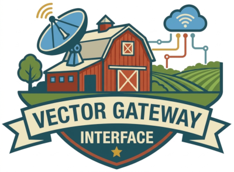

# Cupola

<p align="center">
  <a href="https://cupola.query-farm.services">
    
  </a>
</p>

A standalone web frontend for browsing VGI (Vector Gateway Interface) database catalogs. Cupola connects to any VGI HTTP server and presents its schemas, tables, views, and functions in a navigable catalog browser — with an embedded SQL shell, pivot tables, and an AI data analysis agent built in.

Designed to be shared across all VGI server implementations (Python, TypeScript, Go). VGI servers redirect browsers to the hosted frontend with `?service={url}`.

## Features

- **Catalog browser** — sidebar tree of schemas, tables, views, functions, and macros with searchable navigation, detail panels, column statistics, and on-demand column profiling
- **Embedded SQL shell** — DuckDB-WASM running in the browser with the VGI extension, an xterm.js terminal, tab completion, session persistence, and dot commands
- **AI data analysis** — Claude-powered agent that can run SQL, inspect schemas, and answer questions about your data (bring your own Anthropic API key)
- **AI file attachments** — attach, paste, or drag files into Ask AI, the SQL editor assistant, notebook assistant, report assistant, and terminal AI mode. Supports PNG/JPEG/GIF/WebP, PDF, text/code/data files, and Excel/ODS workbooks. Files are prepared locally and sent to Claude with your message; they remain in the in-memory conversation, and are not imported into DuckDB or saved with reports/notebooks. Up to 10 files per message, 10 MB per file (5 MB for images), and 20 MB combined. Text extraction is limited to 200,000 characters per file and workbooks to 10,000 rows per sheet; larger files must be split. PDF page/context limits also depend on the selected model. Terminal files attach to the next request in `.ai` mode. Attachment payloads are omitted from AI telemetry.
- **Pivot tables** — Perspective-based data grids backed directly by DuckDB-WASM
- **Data preview** — paginated table browsing, geometry (WKB) visualization, example queries, and Markdown descriptions via VGI tags
- **Deep linking** — selection state encoded in the URL hash so views can be shared
- **OAuth / PKCE** — works with VGI servers that require authentication, including per-catalog identity
- **Theming** — custom color themes loadable via `?theme=<url>`, with a live editor at `/theme-builder`

## Shared document library

The sidebar Library combines local saved documents and workers advertising `vgi.objects.v1`.
Reports, notebooks and named queries share folders, search/type filters, revision history,
ownership, links and copy/move workflows. Query tabs and notebooks retain local recovery
drafts; **Save to library** writes a versioned object independent of an open tab. Closing a
query tab does not delete its saved object. Opening shared SQL never executes it.

The Reports overview shows only reports, with name and description search, and schedules.
Use the sidebar Library to manage all saved object types. Folder contents include queries,
notebooks, and reports; each opens in its respective editor.

Cupola prefers objects, generic ownership discovery and schedules v2, and falls back to
report-only workers. Pending writes and transfers retain their original protocol/request ID
across upgrades. Copies preserve opaque bytes and unknown fields. CAS conflicts preserve
the local draft; retry ambiguous saves before starting another mutation.

Saved notebook/query documents carry explicit catalog aliases, locations and default schema.
Share links provision those catalogs through the normal consent flow; credentials, local
workspace IDs and result buffers are excluded. Running uses an isolated connection and
refuses missing or mismatched bindings. Bound query documents support result snapshots in
Perspective; its live-query mode is disabled until it can carry the isolated context.

Only reports currently support scheduling and PDF/HTML email delivery. Notebook execution
stays interactive; worker SQL tasks, scheduled queries and data-alert evaluation remain
unadvertised. Worker permission hints guide the UI and the worker enforces access.

The reporting contracts are generated from the companion `vgi-python` checkout with
`../vgi-python/.venv/bin/python scripts/generate-reporting-contracts.py`.
`bun test ./tests/unit`, `bun test tests/reporting/*.integration.test.ts`, and Playwright's
`tests/objects.spec.ts`, `tests/reporting.spec.ts`, `tests/report-scheduling.spec.ts` exercise
this integration against isolated real Python HTTP workers; email is captured locally.

## Stack

- [Astro](https://astro.build) + [React](https://react.dev) — static site with React islands
- [ShadCN/UI](https://ui.shadcn.com) + [Tailwind CSS](https://tailwindcss.com) — components and styling
- [DuckDB-WASM](https://duckdb.org/docs/api/wasm/overview.html) — in-browser SQL engine
- [Perspective](https://perspective.finos.org) — pivot tables and data grids
- [xterm.js](https://xtermjs.org) — terminal emulator for the SQL shell
- [Bun](https://bun.sh) — package manager and runtime
- Hosted on a Cloudflare Worker with versioned assets served from R2

## Getting Started

```sh
# Install dependencies
bun install

# Start the dev server at http://localhost:4321
bun run dev
```

Cupola needs a running VGI server to talk to. Point it at one with the `service` query parameter:

```
http://localhost:4321/?service=http://localhost:9003
```

Without `?service=`, a welcome / connect page is shown.

## Mobile browser prototype

On the `codex/mobile-browser-prototype` branch, the connected app uses mobile navigation below 768px. Open `/mobile-preview` under the app's versioned base URL for a resizable phone preview with a runnable sample query. For example, run `bun run dev -- --host 0.0.0.0 --port 4337`, then visit `http://localhost:4337/v0.4.238/mobile-preview` (use the version in `package.json`). The preview connects to Cupola's public test service; its starter query contains explicitly labeled sample data.

The prototype includes Ask / Explore / SQL / Library / More navigation, addressable views and browser Back, focused Query / Results / Assistant panes, record and grid results, a modal catalog drawer, report filter sheets, and viewport adjustments for mobile keyboards. Desktop layouts use the same sessions and components. AI uses the existing provider configuration and requires an API key.

Mobile uses one 52px header with a hamburger that opens the catalog drawer and a workspace picker; Cupola branding is inside the drawer, and the active destination is labeled in the bottom navigation. Catalog object pages show the current object with a parent link, move actions into a sheet, and present columns and function arguments as vertical metadata rows. Column sorting and query actions remain available. Library retains its functional Reports / Notebooks selector.

This is a browser prototype: it does not add installation, offline execution, background jobs, or cross-device synchronization. Playwright covers query execution and retained results, rotation, navigation history, settings, catalog dialogs, and report filters in Chromium and WebKit. Real-device keyboard, authentication, downloads, and memory testing remain necessary before release.

Existing notebook editing, pivot exploration, and exports remain reachable through the existing components. Their advanced authoring controls still need a dedicated touch review. The largest remaining product question is how much local query execution a phone can sustain; this prototype preserves the existing engine and does not claim a mobile performance improvement.

### Catalog mobile survey — October 13, 2026

The findings below describe the baseline before the catalog readability changes. The subsequent prototype iteration is recorded after the survey table.

Reviewed all 38 catalog routes exposed by the public test service: one catalog, three schemas, four tables, one view, 20 functions (including table-backing functions), six macros, and three relationship views. Chromium coverage used 320, 360, 390, and 430px widths; seven representative routes were also checked in WebKit at 320 and 390px, for 166 route/viewport observations. Example-query accordions were expanded. Separate synthetic fixtures rendered the actual metadata, documentation, memory-catalog, and cached numeric-profile components with long values; these did not modify service data.

The sampled routes fit the viewport, but **30 of 38 still contain horizontally scrolling SQL at 390px** (33 at 320px). Fitting the outer page is therefore insufficient. Long-value fixtures also exposed clipping and unreadable wrapping that a document-width assertion misses.

| Priority | Surface and observed problem | Proposed mobile treatment |
| --- | --- | --- |
| 1 | [Example queries](src/components/content/ExampleQueries.tsx) across schemas, tables, views, functions, and macros. Copy/Run beside the code leave a 177px SQL lane at 390px, and only 107px at 320px. Their buttons are 24px tall. | Put actions in a compact toolbar above a full-width code block. Offer wrap and expand controls, with 44px touch targets. Keep Copy, Run, and open-in-editor behavior. |
| 1 | [Tags](src/components/content/TagsTable.tsx) and [documentation links](src/components/content/DocLinks.tsx). A long tag key forces its value out of the visible card; a long untitled URL expands a 390px fixture to 898px. | Stack tag keys over values. Bound link width and wrap the label/URL without losing the full destination. Do not mask the problem with overflow hiding. |
| 1 | [Expanded column profiles](src/components/content/ColumnProfile.tsx). Side-by-side statistics split large numbers across lines; even “Distribution” splits in the stress fixture. | Stack summary and percentile sections; put labels and complete numeric values on readable rows. Move sample/null counts below the heading and keep charts available. |
| 2 | [View/macro definitions](src/components/content/SqlCodeBlock.tsx) and [connection snippets](src/components/ConnectBox.tsx). The catalog connection snippet needs 931px inside a 334px block. | Share the full-width SQL reader and wrap/expand controls. Put connection instructions behind a compact disclosure on phones. Preserve exact text for copying. |
| 2 | [Markdown documentation tables](src/components/content/MarkdownContent.tsx). Cells enforce no wrapping; a four-column parameter fixture needs 636px inside a 364px viewport. | Allow descriptive cells to wrap and offer a full-width expanded view for wide tables. Use labeled rows where the table structure supports them; preserve the comparison grid as an option. |
| 2 | [Relationships](src/components/content/CatalogRelationships.tsx). Controls occupy 137px at 390px, rising to 175px at 320px. Showing the two unrelated geo tables fits the diagram at 56%, making labels tiny. | Default to a readable table/relationship list with drill-in and Create JOIN actions. Keep the diagram as an explicit view and place filters in a sheet. |
| 2 | [Catalog overview](src/components/content/CatalogOverview.tsx). Expanded documentation and connection instructions push the schema list below the initial screen. | Put schemas and search near the top; make documentation and connection details expandable secondary sections. |
| 3 | [Column lists](src/components/content/ColumnsTable.tsx), function arguments, and [memory catalog rows](src/components/content/MemoryCatalogOverview.tsx). Main metadata now fits, but rows remain tall. Long memory-schema names squeeze “1 table” into multiple broken lines. | Keep name/type together where space permits, reveal secondary details on tap, and place counts below long names. Retain sorting, nullability, constraints, and profiling. |

The tested keyword chips, provenance links, and ordinary memory-schema rows fit. Dense connected FK graphs and their selected-edge controls, complex constraints, and physical-device behavior remain follow-up cases; the public sample has no declared foreign keys. This survey does not establish mobile readiness for every possible catalog payload. Intentional grid/diagram panning can remain, but basic catalog reading should not require sideways scrolling.

Baseline evidence is in `.playwright-mcp/catalog-survey/` (generated, gitignored): `results.json`, `stress-results.json`, and screenshots. The scratch drivers are `.playwright-mcp/catalog-survey.mjs` and `.playwright-mcp/catalog-stress.mjs`.

### Catalog readability changes in the local prototype

SQL examples, definitions, and connection snippets now use a shared reader: full-width code, wrapping enabled by default on phones, an optional unwrapped view, and an expanded dialog. Copy and Run preserve the formatted SQL text. The 390px example-query reading area grew from 177px to 316px; actions have 44px touch targets. Long blocks have a bounded preview, with the complete content available in the reader.

Tag keys and values stack, documentation links wrap, numeric profiles keep numbers intact, and chart labels sit above their bars on narrow screens. Documentation tables wrap in place and offer an expanded comparison grid. Column names and types share a row, while memory-schema counts sit beneath long names. Catalog schemas precede long documentation and connection instructions, which start collapsed on phones.

Relationships default to a table list on phones, with declared links, cardinality, table navigation, neighborhood focus, and Create JOIN query. Filters live in a sheet and the diagram remains selectable. The header measures 65px at 320–430px, down from 137–175px. Desktop retains the diagram as its default. Preparing a JOIN does not automatically execute it.

The repeated survey covered the same 38 routes and 166 viewport observations, with example queries and optional documentation/connection sections open: no page overflow or horizontally overflowing SQL remained in the default wrapped view. Stress fixtures covered long metadata, large numeric values, Markdown tables, and a connected FK graph. Wide comparison grids and the explicitly selected diagram still support panning. Physical-device and unusually dense catalog testing remain follow-up work.

After-change evidence is in `.playwright-mcp/catalog-improvements/`, generated by `.playwright-mcp/catalog-survey-after.mjs` and `.playwright-mcp/catalog-stress-after.mjs`. Focused Chromium/WebKit checks cover query copying/running, the expanded reader, disclosure layout, relationship filtering/navigation, and existing column sorting. Component tests also verify mobile and desktop JOIN preparation and Markdown table copying. The production build and bundle budget pass. These changes remain in the existing local worktree; no separate mobile site or deployment was created.

### Mobile-web design references

These comparisons concern browser experiences. The suggested applications to Cupola are design recommendations, not claims of feature parity or hands-on testing of the other products.

| Service | Documented mobile-browser approach | What to apply to Cupola |
| --- | --- | --- |
| [Sigma](https://help.sigmacomputing.com/docs/design-workbook-layouts) | Responsive workbooks with an optional custom mobile layout; data and element changes remain shared between layouts. | Keep one workspace and data model, while choosing a different presentation for phones. This prototype does that for navigation, query panes, records, and filters. |
| [Google Data Studio](https://docs.cloud.google.com/data-studio/create-a-responsive-report) | Responsive reports group charts and controls into sections and provide phone/tablet previews. | Make report sections readable in a vertical flow and review at explicit device widths. The prototype supplies a resizable browser preview; further report-layout refinement can follow. |
| [Metabase](https://discourse.metabase.com/t/how-to-get-a-mobile-version-of-metabase/13819) | Its official support answer describes access through a responsive mobile web app (March 2021). Its [dashboard documentation](https://www.metabase.com/docs/latest/dashboards/introduction) covers questions, filters, and drill-through. | Keep exploration and filtering available on a phone. Cupola uses a catalog drawer and filter sheets to give those tasks room. The historical support answer does not establish current mobile authoring parity. |

The proposed first release should focus on asking questions, finding data, reading and filtering reports, and running or adjusting SQL. Keep advanced tools available through progressive disclosure. Before expanding mobile authoring, validate these tasks on physical iOS and Android browsers with representative data volumes, real sign-in, the software keyboard, and downloads.

Run the focused checks against a running VGI service with `CUPOLA_APP_ORIGIN=http://127.0.0.1:4337 VGI_SERVICE_URL=<service-url> bunx playwright test tests/responsive.spec.ts tests/mobile-browser.spec.ts --browser=webkit --workers=1` (use `--browser=chromium` for Chromium).

## Commands

| Command           | Action                                       |
| :---------------- | :------------------------------------------- |
| `bun install`     | Install dependencies                         |
| `bun run dev`     | Start local dev server at `localhost:4321`   |
| `bun run build`   | Build the production site to `./dist/`       |
| `bun run preview` | Preview the production build locally         |
| `bun run test`    | Run unit tests                               |
| `bun run test:e2e:smoke` | Run the Chromium CI smoke suite against `VGI_SERVICE_URL` |
| `bun run check`   | Type-check Astro, React, and test sources    |
| `bun run check:bundle` | Enforce the production JS size budget after a build |
| `bun run audit`   | Report production dependency advisories     |
| `bun run image:build` | Build the self-hosted Caddy image as `cupola:flat` |
| `bun run image:test` | Smoke-test the locally built container image |
| `./publish.sh`    | Publish a new version (build, upload to R2, deploy) |

## URL Parameters

| Parameter | Purpose |
|-----------|---------|
| `?service=<url>` | VGI server base URL to connect to |
| `?attach_options=<sql>` | Extra options spliced into the DuckDB `ATTACH` statement |
| `?vgi_version=latest` | Use the community repository's current VGI extension for this tab session (omit the `VERSION` clause) |
| `?vgi_version=<version>` | Pin an exact VGI extension build for this tab session; use `default` to clear the override |
| `?theme=<url>` | URL of a theme JSON file (colors, logo, terminal theme) |
| `?fresh` | Clear any saved DuckDB session snapshot for this service |
| `#ai_key=<key>` | Anthropic API key for the AI agent (stripped from the URL after use) |
| `#/schema/<s>/table/<t>` | Deep link to a catalog selection |

## Deployment

The public Worker serves the current app at stable document URLs. `/latest/` and
historical `/v{version}/` page URLs redirect to those addresses; JavaScript, WASM,
and other assets stay under immutable `/v{version}/...` paths. Self-hosted builds
keep their configured base and do not check the public release service.

Publishing reserves a fresh version, uploads assets, verifies every uploaded file's
size, deploys the backward-compatible Worker, and promotes `_latest` last using a
conditional write. Never reuse a version after a partial upload; bump it and retry.
A local publish does not push a tag (which would start a duplicate CI deployment).
Do not run local publishing/rollback while CI publishing or cleanup is active.

`/release.json` is uncached. Hosted tabs check it every five minutes and when
returning to the tab; updates require an explicit reload. Existing tabs from before
this feature need one navigation/reload before they can display update notices.

Rollback: `./scripts/releases.sh rollback <version>` switches the current frontend
to a retained release; it does not roll back Worker code or browser data. Keep
Worker routing and saved-data formats compatible with retained frontends.

Retention: `./scripts/releases.sh cleanup` reports candidates; `--delete` applies
the plan. Keep all releases for 30 days, the current release, and two recent
rollback candidates. Activation refreshes a release's retention lease. Incomplete
uploads also expire after 30 days. Root-level legacy files are not deleted.
The daily Release retention workflow shares CI's production lock and defaults to
dry-run. Set the production environment variable `CUPOLA_CLEANUP_DELETE=true`
after reviewing its report to enable deletion. Very old tabs may need a reload
once their assets expire; historical hosted versions are not a supported product.

**Publish locally:**

1. Bump `version` in `package.json`
2. Run `./publish.sh`

Pull requests and pushes to `main` run the **CI** workflow (`.github/workflows/ci.yml`): frozen installs, type checking, unit tests, a production build, bundle-size enforcement, and Chromium smoke tests against the hosted Open-Meteo VGI service. Dependency advisories are reported there without failing the build until the existing audit backlog is resolved.

### Releases

Releases are tag-driven. Update `package.json` to the next unused version,
commit it, then push the matching tag:

```sh
git tag v0.4.116
git push origin v0.4.116
```

The **Release** workflow requires the tag to exactly match `package.json`. It
then runs the complete validation suite, publishes a multi-platform image to
GHCR, deploys the versioned Cloudflare/R2 site in a separate job, and creates a
GitHub Release with generated notes after both publishing jobs succeed.

Required repository secrets:

| Secret | Purpose |
|--------|---------|
| `SENTRY_AUTH_TOKEN` | Sentry source-map upload |
| `CLOUDFLARE_API_TOKEN` | Worker deploy |
| `R2_ACCESS_KEY_ID` / `R2_SECRET_ACCESS_KEY` | R2 S3-API asset upload |

The GitHub-provided token publishes the container; no registry password is
required. The GHCR package must be made public once in the repository/package
settings so unauthenticated users can pull it.

### Self-hosting with Docker

Release images support both `linux/amd64` and `linux/arm64`:

```sh
docker run --rm -p 8080:80 ghcr.io/query-farm/cupola:latest
```

Open `http://localhost:8080/?service=https://your-vgi-server.example`. Exact
release and minor-line tags are also published, for example `0.4.116` and
`0.4`. The image is a static Caddy server and does not embed a VGI endpoint;
the `service` URL remains runtime-configurable.

To build locally, run `bun run image:build`, followed by
`bun run image:test`. All VGI client dependencies are installed from npm; no
sibling repository checkout is required.

## License

Licensed under the [Apache License 2.0](LICENSE).

Copyright © 2026 Query Farm LLC — [https://query.farm](https://query.farm)
